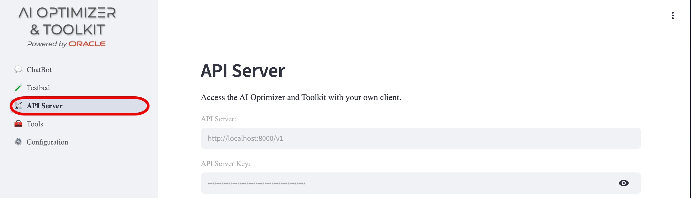
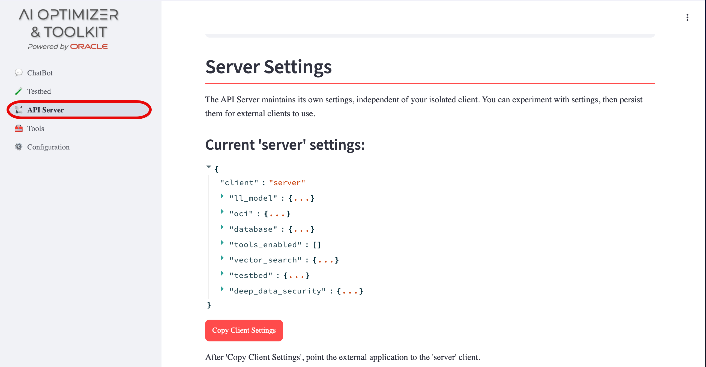
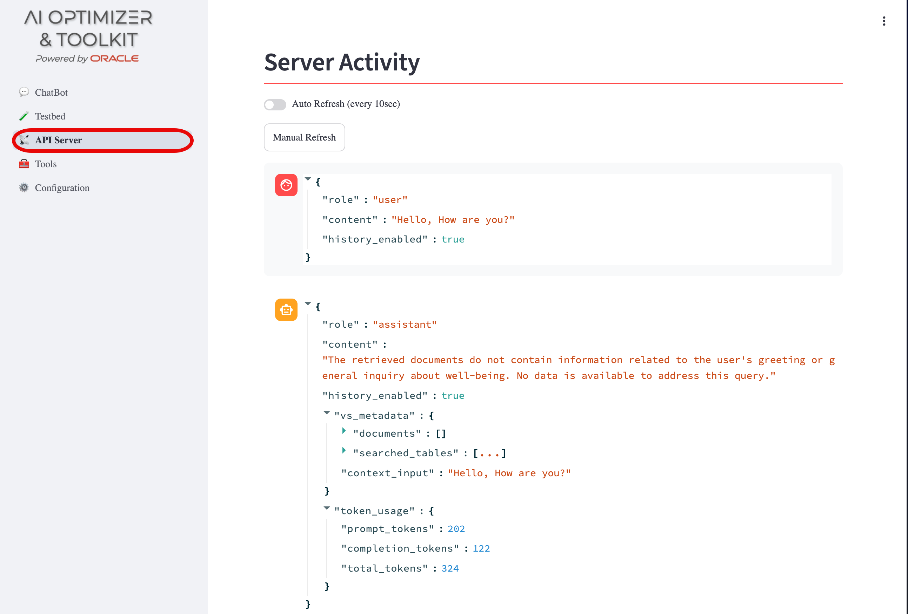

{/* Copyright (c) 2024, 2026, Oracle and/or its affiliates.
Licensed under the Universal Permissive License v1.0 as shown at http://oss.oracle.com/licenses/upl. */}

The **Oracle AI Optimizer and Toolkit** (the **AI Optimizer**) includes an API Server that lets compatible clients access its features. The API Server can run with the provided **AI Optimizer** web client (the "All-in-One" deployment) or as a separate process.

Connected clients share database, model, OCI, and prompt configurations. Each client can separately select a database, language model, OCI profile, enabled tools, and Vector Search options, making independent agent and flow experiments possible on the same server.

When several people use one server, [separate client sessions](../server/multi-user-sessions) keep their conversations and working selections apart. To protect the shared configuration resources, see [Access Control](../guides/access-control).

## Server Configuration

When the API Server starts, it creates a `server` client from the configured client settings if one does not already exist. The `server` client is the default for external chat calls that do not specify a client. To copy the current web client's settings to the `server` client for use by external applications, click **Copy Client Settings**.

External clients authenticate with an Oracle database or OIDC bearer token.

For API request details, see [AI Optimizer Server](../server/intro).

You can review the `server` client's settings by expanding the `{...}` brackets. The copy action transfers client-specific settings only; shared configuration remains unchanged, and runtime-only Deep Data Security settings are not copied.

## Server Activity

Server Activity displays chat interactions that use the `server` client. Toggle **Auto Refresh** or select **Manual Refresh** to view interactions from outside the **AI Optimizer** web client.

