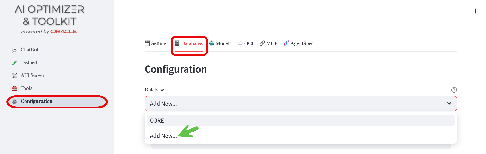

{/* Copyright (c) 2024, 2026, Oracle and/or its affiliates.
Licensed under the Universal Permissive License v1.0 as shown at http://oss.oracle.com/licenses/upl. */}

Use **Configuration** > **Databases** to view the required database connection, add connections for feature data, select the database used by the client, and manage vector stores. For provisioning, startup configuration, wallets, and database-user requirements, see [Oracle AI Database](../../guides/database).

## Required Database Connection

The page displays the required connection with the reserved alias **CORE**, its connection status, and redacted settings. The deployment startup configuration controls CORE. Update that configuration and restart the Server to apply changes.

## Additional Database Connections

Select **Add New...** from the database list to add a connection with a custom alias. Additional databases can provide data for Split/Embed, Vector Search, and NL2SQL.

The selected database is used for Split/Embed, Vector Search, and NL2SQL. Confirm the selection before working with data when more than one database is configured.



### Configuration Fields

Provide the following inputs:

- **Alias**: A unique identifier for an additional database connection
- **Username**: The pre-created [database username](../../guides/database#database-user)
- **Password**: The password for the **Username**
- **DSN (Connect String)**: The full connection string or [TNS alias](../../guides/database#using-a-wallettns_admin). Common formats include:

  ```
  (DESCRIPTION=(ADDRESS=(PROTOCOL=tcp)(HOST=<hostname>)(PORT=<port>))(CONNECT_DATA=(SERVICE_NAME=<serviceName>)))
  ```

  or:

  ```
  //<hostname>:<port>/<serviceName>
  ```
- **Wallet Password** (_Optional_): The wallet password for an mTLS connection. See [Using a Wallet](../../guides/database#using-a-wallettns_admin) for setup instructions.

Select **Create** to add the connection. You can save changes to or remove an existing additional connection.

### Vector Stores

The page lists the vector stores in the selected database. Removing a vector store drops its database table and the embeddings stored in that table.

### NL2SQL Access

NL2SQL uses the account configured for the selected database. See [NL2SQL Access](../../guides/database#nl2sql-access) for database-user and privilege guidance.
