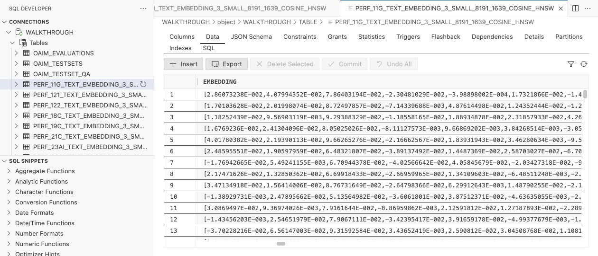
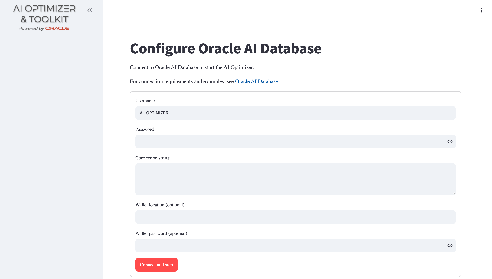

{/* Copyright (c) 2024, 2026, Oracle and/or its affiliates.
Licensed under the Universal Permissive License v1.0 as shown at http://oss.oracle.com/licenses/upl. */}

import OracleAiDatabaseFree from '../_assets/partials/oracle-ai-database-free.mdx';
import DeepDataSecurityPrivileges from '../_assets/partials/deep-data-security-privileges.mdx';

The [**Oracle AI Database**](https://www.oracle.com/database/) is required by the **AI Optimizer Server**. The database is used to store:

- **AI Optimizer** settings and configuration
- [Testbed](../client/testbed) question-and-answer test sets and evaluations
- background job state

The required connection and any additional database connections can also provide:

- vector stores for document embeddings used in Retrieval-Augmented Generation (RAG)
- structured data for Natural Language to SQL (NL2SQL)



:::warning[Required at startup]
Server startup requires complete database settings, a successful connection, and schema initialization.
:::

Oracle Autonomous Database and [Oracle AI Database Free](https://www.oracle.com/database/free/get-started/) are supported. Oracle AI Database Free provides a no-cost option for local development.

## Database Configuration

How you provide the required Oracle AI Database connection depends on how you run the AI Optimizer.

### Bare Metal and Containers

For bare-metal and container installations, set `AIO_DB_USERNAME`, `AIO_DB_PASSWORD`, and `AIO_DB_DSN` in the environment. You can set them in the shell, in `src/.env.dev`, or pass them to the container. Wallet connections can also use `AIO_DB_WALLET_LOCATION` and `AIO_DB_WALLET_PASSWORD`. See [Environment Variables](./env-vars#database) for details.

If you start the bare-metal client or all-in-one container without the three required variables, the client opens a setup page:



Settings entered on the bare-metal setup page last until the client stops. The all-in-one container stores them in its application-data volume.

:::note[Standalone Server]
The setup page is provided by the client. If you run the [Server](../server/intro) directly, set the database environment variables before starting it.
:::

### Helm and Kubernetes

With Helm, set the database mode and connection details under `server.database`. Store the username, password, and connection service in a Kubernetes Secret, then reference it with `server.database.authn.secretName`. The chart adds those credentials to the Server deployment.

The [Kubernetes / Helm](../advanced-guides/k8s-helm#configure-the-database) guide covers the supported database modes and Secret formats.

### Client Display

After the Server starts, the [Databases](../client/configuration/databases) page displays the required connection with the reserved alias **CORE**. The deployment startup configuration controls CORE. Use the page to add and select database connections for Split/Embed, Vector Search, and NL2SQL.

## Run Local Oracle AI Database Free

For a local development environment, you can run Oracle AI Database Free in a container:

<OracleAiDatabaseFree />

After the database is ready, create a database user as described in [Database User](#database-user). When configuring the **AI Optimizer** on the same host, use `//localhost:1521/FREEPDB1` as the connect string.

## Using a Wallet/TNS_ADMIN

For mTLS database connectivity, or to use a TNS alias instead of a full connect string, use the contents of a `TNS_ADMIN` directory.

:::info[Great things come from unzipped files]

For an ADB-S wallet, unzip its contents into the `TNS_ADMIN` directory. The `.zip` file is not recognized.

:::

### Bare-Metal

For bare-metal installations, set the `TNS_ADMIN` environment variable to the location of your unzipped wallet files before starting the **AI Optimizer**.

### Container

When starting the container, mount the `TNS_ADMIN` directory at `/app/tns_admin`.

For example:

```bash
podman run -v $TNS_ADMIN:/app/tns_admin -p 8501:8501 -it --rm localhost/ai-optimizer-aio:dev
```

## Database User

The required database connection uses an application user that can create, read, and write the **AI Optimizer** schema objects. Vector Search and NL2SQL use the account configured for the selected database. Create dedicated application users in application tablespaces and grant the access needed for each connection.

For Oracle AI Database Free running in a container, connect as a privileged user and select the pluggable database:

```bash
podman exec -it ai-optimizer-db sqlplus '/ as sysdba'
```

```sql
ALTER SESSION SET CONTAINER=FREEPDB1;
```

Use the following local-development example to create a database user. It grants `DB_DEVELOPER_ROLE` and an unlimited quota on the default permanent tablespace. For other environments, grant only the privileges and quota required for the intended use. Change the value of `c_user_password`:

```sql
DECLARE
    c_user_name     CONSTANT VARCHAR2(30) := 'DEMO';
    c_user_password dba_users.password%TYPE := 'MYSUPERSECRET';
    v_default_perm  database_properties.property_value%TYPE;
    v_default_temp  database_properties.property_value%TYPE;
    v_sql           VARCHAR2(500);
BEGIN
    SELECT property_value
    INTO v_default_perm
    FROM database_properties
    WHERE property_name = 'DEFAULT_PERMANENT_TABLESPACE';

    SELECT property_value
    INTO v_default_temp
    FROM database_properties
    WHERE property_name = 'DEFAULT_TEMP_TABLESPACE';

    v_sql := 'CREATE USER ' || DBMS_ASSERT.ENQUOTE_NAME(c_user_name, FALSE) ||
            ' IDENTIFIED BY "' || c_user_password || '" ' ||
            'DEFAULT TABLESPACE ' || v_default_perm || ' ' ||
            'TEMPORARY TABLESPACE ' || v_default_temp;
    EXECUTE IMMEDIATE v_sql;

    EXECUTE IMMEDIATE 'GRANT DB_DEVELOPER_ROLE TO ' ||
        DBMS_ASSERT.ENQUOTE_NAME(c_user_name, FALSE);
    EXECUTE IMMEDIATE 'ALTER USER ' ||
        DBMS_ASSERT.ENQUOTE_NAME(c_user_name, FALSE) || ' DEFAULT ROLE ALL';
    EXECUTE IMMEDIATE 'ALTER USER ' ||
        DBMS_ASSERT.ENQUOTE_NAME(c_user_name, FALSE) || ' QUOTA UNLIMITED ON ' ||
        DBMS_ASSERT.ENQUOTE_NAME(v_default_perm, FALSE);
END;
/
EXIT;
```

:::tip[Separate development schemas]

Creating multiple users in the same database allows developers to separate their experiments by changing the Database User.

:::

### NL2SQL Access

NL2SQL uses the account configured for the selected database. Grant this account only the permissions needed for the intended objects and operations, such as `CREATE SESSION` and `SELECT` on specific tables or views.

SQLcl restrict level `4` blocks host commands, scripts, and configuration-changing SQLcl commands by default. Database privileges still determine which SQL statements the account can run.

The NL2SQL prompt requests read-only queries. The SQL tool can submit DML, DDL, and PL/SQL when the account has those privileges.

## Deep Data Security Privileges

<DeepDataSecurityPrivileges />
