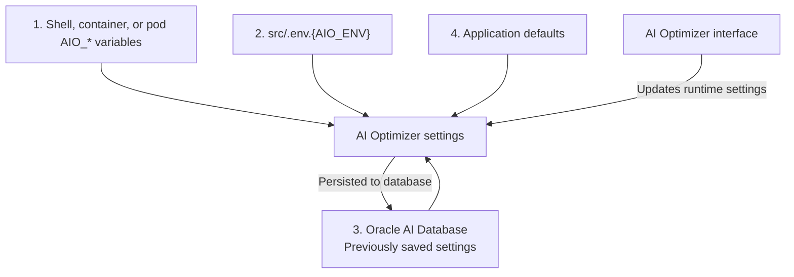

{/* Copyright (c) 2024, 2026, Oracle and/or its affiliates.
Licensed under the Universal Permissive License v1.0 as shown at http://oss.oracle.com/licenses/upl. */}

## Getting Started

Most application settings can be configured in the [AI Optimizer interface](../client/configuration). The required database connection is startup configuration. You can provide environment variables in two ways:

- Create an environment file. This is the **preferred approach** for reusable local configuration because it keeps related settings together.
- Export values in the shell before starting the application. This is useful for temporary configuration and deployment platforms that inject environment variables.

To create the recommended environment file for local use, copy the example:

```bash
cp src/.env.example src/.env.dev
```

Then edit `src/.env.dev`. A direct Server process requires these database settings:

```dotenv
AIO_DB_USERNAME=demo
AIO_DB_PASSWORD=replace-with-your-password
AIO_DB_DSN=localhost:1521/FREEPDB1
```

To export values from the shell for a temporary configuration:

```bash
export AIO_DB_USERNAME=demo
export AIO_DB_PASSWORD=replace-with-your-password
export AIO_DB_DSN=localhost:1521/FREEPDB1
```

:::note[Required database connection]
A valid database configuration (`AIO_DB_USERNAME`, `AIO_DB_PASSWORD`, and `AIO_DB_DSN`) is required before the Server can start. The Server uses this database for application settings, Testbed data, and background job state. The bare-metal client launcher can retain setup-page values in memory for the current process; the all-in-one container stores them in its configured application-data volume.
:::

### Common Starting Configurations

To use a hosted model, configure its provider key. For example:

```dotenv
AIO_OPENAI_API_KEY=replace-with-your-api-key
```

To use a local Ollama model, set its URL:

```dotenv
AIO_ON_PREM_OLLAMA_URL=http://127.0.0.1:11434
```

See [AI Models](./ai-models) for model-provider setup and [Oracle AI Database](./database) for database connection details.

:::warning[Secrets inside]
Environment files can contain API keys, database credentials, wallet passwords, private-key material, and telemetry headers. Keep populated environment files out of source control. For shared or hosted deployments, use the platform's secret-management facilities.
:::

## How Configuration Works

At startup, the application uses the following precedence:



## Environment Files

The entrypoint reads `AIO_*` variables from the process environment, then fills the remaining settings from `src/.env.{AIO_ENV}`. In a POSIX shell, use `export` so the application inherits the variables.

Set `AIO_ENV` before startup to select an environment file. If it is unset, the application uses `dev`.

| `AIO_ENV` value | File loaded         |
| --------------- | ------------------- |
| `dev` (default) | `src/.env.dev`      |
| `prd`           | `src/.env.prd`      |
| _custom_        | `src/.env.{custom}` |

Restart the affected component after changing an environment variable.

`AIO_*` variables are specific to the **AI Optimizer**. Integrations such as OpenTelemetry and OpenInference use their own variables. See [Database Configuration](./database#using-a-wallettns_admin) for `TNS_ADMIN`.

Values supplied through `AIO_*` variables are reapplied at startup. Interface changes to matching application settings apply to the running process until the next restart. The required database connection is startup configuration. For this connection, `DB_*` environment variables take precedence over `AIO_DB_*`; for OCI profiles, `OCI_CLI_*` variables take precedence over `AIO_OCI_CLI_*`.

## Environment Variables

### Application

| Variable        | Description                                                                                         | Default |
| --------------- | --------------------------------------------------------------------------------------------------- | ------- |
| `AIO_ENV`       | Selects the `src/.env.{AIO_ENV}` file and labels the deployment environment. Set it before startup. | `dev`   |
| `AIO_LOG_LEVEL` | Python logging level                                                                                | `INFO`  |

### Authentication

| Variable      | Description                                                                                                                                                                                      | Default       |
| ------------- | ------------------------------------------------------------------------------------------------------------------------------------------------------------------------------------------------ | ------------- |
| `AIO_API_KEY` | API key for authenticating requests to the [**AI Optimizer Server**](../server/intro.mdx). In an all-in-one deployment, the Client generates and displays a shared key when this variable is unset. Set it explicitly for a standalone Server. | _(generated)_ |

### Client

| Variable                   | Description                                                                                                                                                                                                    | Default     |
| -------------------------- | -------------------------------------------------------------------------------------------------------------------------------------------------------------------------------------------------------------- | ----------- |
| `AIO_CLIENT_ADDRESS`       | Client listen address                                                                                                                                                                                          | `localhost` |
| `AIO_CLIENT_PORT`          | Client listen port                                                                                                                                                                                             | `8501`      |
| `AIO_CLIENT_COOKIE_SECRET` | Signing key for Streamlit's signed cookies. Multi-replica deployments must provide the same value to every replica.                                                                                             | _(none)_    |
| `AIO_CLIENT_PASSWORD`      | Shared password gating configuration and shared-state controls in the web client. Configure [**AI Optimizer Server**](../server/intro.mdx) authentication separately. See [Access Control](./access-control). | _(none)_    |
| `AIO_CLIENT_SSL`           | Enables TLS for the Client                                                                                                                                                                                     | `false`     |
| `AIO_CLIENT_SSL_CERT_FILE` | Path to a TLS certificate in PEM format                                                                                                                                                                        | _(none)_    |
| `AIO_CLIENT_SSL_KEY_FILE`  | Path to a TLS private key in PEM format                                                                                                                                                                        | _(none)_    |

### Server

| Variable                   | Description                                                                                                                                                                            | Default            |
| -------------------------- | -------------------------------------------------------------------------------------------------------------------------------------------------------------------------------------- | ------------------ |
| `AIO_SERVER_URL`           | URL the client uses to reach the [**AI Optimizer Server**](../server/intro.mdx). Set it when the client connects to a separately deployed, remote, or reverse-proxied instance.        | `http://localhost` |
| `AIO_SERVER_URL_PREFIX`    | URL path prefix for the [**AI Optimizer Server**](../server/intro.mdx), such as `/optimizer`                                                                                           | _(none)_           |
| `AIO_SERVER_ADDRESS`       | [**AI Optimizer Server**](../server/intro.mdx) bind address. A standalone instance uses `0.0.0.0`; client autostart uses `127.0.0.1`. Clients should connect through `AIO_SERVER_URL`. | component-specific |
| `AIO_SERVER_PORT`          | [**AI Optimizer Server**](../server/intro.mdx) listen port                                                                                                                             | `8000`             |
| `AIO_SERVER_SSL`           | Enables TLS for the [**AI Optimizer Server**](../server/intro.mdx)                                                                                                                     | `false`            |
| `AIO_SERVER_SSL_CERT_FILE` | Path to a TLS certificate in PEM format. Set only `AIO_SERVER_SSL` to generate a self-signed certificate.                                                                                      | _(none)_           |
| `AIO_SERVER_SSL_KEY_FILE`  | Path to the TLS private key in PEM format                                                                                                                                              | _(none)_           |
| `AIO_SERVER_READY_TIMEOUT` | Seconds the client waits for the [**AI Optimizer Server**](../server/intro.mdx) to become ready at startup                                                                             | `180`              |
| `AIO_MAX_CLIENTS`          | Maximum number of distinct client sessions cached in memory                                                                                                                            | `64`               |
| `AIO_MCP_CACHE_TTL_SECONDS` | Seconds modern MCP clients may retain cacheable responses in a private cache. Set to `0` for immediate refresh.                                                                        | `5`                |

### Database

These variables configure the required database connection. Username, password, and DSN must be supplied together. See [Database Configuration](./database) for connection formats, wallet setup, and required privileges.

| Variable                 | Description                                       | Default  |
| ------------------------ | ------------------------------------------------- | -------- |
| `AIO_DB_USERNAME`        | Database username                                 | _(none)_ |
| `AIO_DB_PASSWORD`        | Database password                                 | _(none)_ |
| `AIO_DB_DSN`             | Connection string or TNS alias                    | _(none)_ |
| `AIO_DB_WALLET_PASSWORD` | Wallet password for mTLS connections              | _(none)_ |
| `AIO_DB_WALLET_LOCATION` | Path to the wallet directory for mTLS connections | _(none)_ |
| `AIO_DB_POOL_SIZE`       | Maximum database connection pool size             | `5`      |

### OCI CLI

These settings populate the DEFAULT OCI profile. See [OCI Configuration](./oracle-cloud-infra.mdx) for authentication requirements and supported authentication types.

| Variable                          | Description                                                    | Default  |
| --------------------------------- | -------------------------------------------------------------- | -------- |
| `AIO_OCI_CLI_AUTH`                | Authentication type, such as `api_key` or `instance_principal` | _(none)_ |
| `AIO_OCI_CLI_TENANCY`             | Tenancy OCID                                                   | _(none)_ |
| `AIO_OCI_CLI_REGION`              | OCI region                                                     | _(none)_ |
| `AIO_OCI_CLI_USER`                | User OCID                                                      | _(none)_ |
| `AIO_OCI_CLI_FINGERPRINT`         | API key fingerprint                                            | _(none)_ |
| `AIO_OCI_CLI_KEY_FILE`            | Path to a private key in PEM format                            | _(none)_ |
| `AIO_OCI_CLI_KEY_CONTENT`         | Inline private-key content                                     | _(none)_ |
| `AIO_OCI_CLI_PASSPHRASE`          | Private-key passphrase                                         | _(none)_ |
| `AIO_OCI_CLI_SECURITY_TOKEN_FILE` | Path to a security-token file                                  | _(none)_ |

#### OCI GenAI

| Variable                   | Description                               | Default  |
| -------------------------- | ----------------------------------------- | -------- |
| `AIO_GENAI_COMPARTMENT_ID` | Compartment OCID for OCI GenAI inference  | _(none)_ |
| `AIO_GENAI_REGION`         | Region for the OCI GenAI service endpoint | _(none)_ |

#### OCI Object Storage Source Lock

Pin the Split & Embed tab's OCI source compartment and, optionally, its bucket for every user of the deployment. The compartment must resolve against the active OCI profile. The bucket applies when it exists in the resolved compartment.

| Variable                               | Description                                                                                                                                            | Default  |
| -------------------------------------- | ------------------------------------------------------------------------------------------------------------------------------------------------------ | -------- |
| `AIO_OCI_SOURCE_BUCKET_COMPARTMENT_ID` | Compartment OCID pinned as the Split & Embed source compartment. When the OCID resolves, the compartment selector is locked for all users.             | _(none)_ |
| `AIO_OCI_SOURCE_BUCKET_NAME`           | Bucket pinned within the configured source compartment when the compartment resolves and contains the bucket. | _(none)_ |

### Models

These settings provide API keys or service URLs and enable matching built-in models at startup.

| Variable                 | Description                                           | Default  |
| ------------------------ | ----------------------------------------------------- | -------- |
| `AIO_COHERE_API_KEY`     | Cohere API key                                        | _(none)_ |
| `AIO_OPENAI_API_KEY`     | OpenAI API key                                        | _(none)_ |
| `AIO_PPLX_API_KEY`       | Perplexity AI API key                                 | _(none)_ |
| `AIO_ON_PREM_OLLAMA_URL` | Ollama API URL, such as `http://127.0.0.1:11434`      | _(none)_ |
| `AIO_ON_PREM_HF_URL`     | Hugging Face TEI URL, such as `http://127.0.0.1:8080` | _(none)_ |
| `AIO_ON_PREM_VLLM_URL`   | vLLM API URL, such as `http://localhost:8000/v1`      | _(none)_ |

### NL2SQL

| Variable              | Description                                       | Default                 |
| --------------------- | ------------------------------------------------- | ----------------------- |
| `AIO_SQLCL_HOME`      | Overrides the SQLcl connection-store directory    | _(temporary directory)_ |
| `AIO_SQLCL_MCP_LEVEL` | SQLcl MCP restrict level; integer from `0` to `4` | `4`                     |

### Observability

| Variable                | Description                                                            | Default |
| ----------------------- | ---------------------------------------------------------------------- | ------- |
| `AIO_OTEL_LOGS_ENABLED` | Enables application log export after OTLP tracing has been configured. | `false` |

The **AI Optimizer** honors the standard [OpenTelemetry SDK environment variables](https://opentelemetry.io/docs/languages/sdk-configuration/). The most relevant ones for operators are listed below.

#### Endpoint and protocol

| Variable                             | Description                                                              | Default                   |
| ------------------------------------ | ------------------------------------------------------------------------ | ------------------------- |
| `OTEL_EXPORTER_OTLP_ENDPOINT`        | OTLP receiver URL (all signals)                                          | _(unset = OTLP disabled)_ |
| `OTEL_EXPORTER_OTLP_TRACES_ENDPOINT` | Trace-specific endpoint (overrides the generic one)                      | _(unset)_                 |
| `OTEL_EXPORTER_OTLP_LOGS_ENDPOINT`   | Log-specific endpoint (overrides the generic one)                        | _(unset)_                 |
| `OTEL_EXPORTER_OTLP_PROTOCOL`        | `grpc` or `http/protobuf` (all signals)                                  | `grpc`                    |
| `OTEL_EXPORTER_OTLP_TRACES_PROTOCOL` | Trace-specific protocol (overrides the generic one)                      | _(unset)_                 |
| `OTEL_EXPORTER_OTLP_LOGS_PROTOCOL`   | Log-specific protocol (overrides the generic one)                        | _(unset)_                 |
| `OTEL_EXPORTER_OTLP_INSECURE`        | Forces plaintext gRPC transport. An `http://` endpoint selects plaintext automatically. | `false`                   |
| `OTEL_EXPORTER_OTLP_HEADERS`         | Comma-separated `k=v` headers (for example, vendor authentication)       | _(unset)_                 |

#### Exporter selection

| Variable               | Description                                                                                                                                 | Default |
| ---------------------- | ------------------------------------------------------------------------------------------------------------------------------------------- | ------- |
| `OTEL_TRACES_EXPORTER` | Comma-separated list. Supported values: `otlp`, `console`, `none`. Unsupported values are ignored.                                          | `otlp`  |
| `OTEL_LOGS_EXPORTER`   | Comma-separated list. Supported values: `otlp`, `none`. Set to `none` to disable log export when `AIO_OTEL_LOGS_ENABLED=true` is in effect. | `otlp`  |

#### Resource attributes

| Variable                   | Description                                                                                                              | Default               |
| -------------------------- | ------------------------------------------------------------------------------------------------------------------------ | --------------------- |
| `OTEL_SERVICE_NAME`        | Service name shown in the backend                                                                                        | `ai-optimizer-server` |
| `OTEL_RESOURCE_ATTRIBUTES` | Comma-separated `k=v` attributes attached to every span (for example, `deployment.environment=prd,service.namespace=ai`) | _(unset)_             |

#### Sampling

| Variable                  | Description                                                                                    | Default                 |
| ------------------------- | ---------------------------------------------------------------------------------------------- | ----------------------- |
| `OTEL_TRACES_SAMPLER`     | Sampler. Common: `parentbased_always_on` (default), `parentbased_traceidratio` (probabilistic) | `parentbased_always_on` |
| `OTEL_TRACES_SAMPLER_ARG` | Sampler argument (for ratio sampler: `0.0`–`1.0`, for example `0.1` for 10%)                   | _(none)_                |

#### Batch span processor tuning

The `OTEL_BSP_*` family (`OTEL_BSP_MAX_QUEUE_SIZE`, `OTEL_BSP_SCHEDULE_DELAY`, and others) is honored by the SDK without code changes. Tune it in production if you observe span drops or back-pressure. See the [SDK configuration specification](https://opentelemetry.io/docs/languages/sdk-configuration/general/) for the full list.

#### OpenInference payload visibility

OpenInference payload fields are hidden by default. Set the relevant `OPENINFERENCE_HIDE_*` variables to `false` only for a backend approved to retain prompts, responses, or retrieved content. See [Full Payload Export](../advanced-guides/observability/intro#full-payload-export) for the supported variables and their effects.

For more information on observability in the **AI Optimizer**, see the [advanced guide](../advanced-guides/observability/intro).

## Containers and Kubernetes

### Container

Pass an environment file when starting a container:

```bash
podman run --env-file src/.env.dev -p 8501:8501 -it --rm localhost/ai-optimizer-aio:dev
```

### Kubernetes

For Kubernetes, configure the application with Helm values and Kubernetes Secrets. See [Kubernetes / Helm](../advanced-guides/k8s-helm) and the [Helm chart](https://github.com/oracle/ai-optimizer/tree/main/helm) for the available settings.
