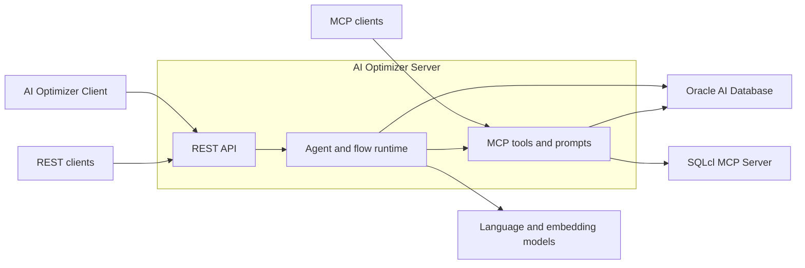

{/* Copyright (c) 2024, 2026, Oracle and/or its affiliates.
Licensed under the Universal Permissive License v1.0 as shown at http://oss.oracle.com/licenses/upl. */}

The **Oracle AI Optimizer and Toolkit** (the **AI Optimizer**) is an open-source platform for building, testing, and evaluating GenAI applications. Its agentic runtime grounds model responses at request time in authoritative private and sensitive data that remains outside the model's training knowledge and under your control in Oracle AI Database.

## What You Can Do

- Run LLM-only and tool-enabled [agents and flows](./advanced-guides/agents/intro).
- Ground responses in unstructured content by [splitting and embedding documents](./client/tools/split-embed) for Vector Search.
- Query structured data in Oracle AI Database through the [NL2SQL agent](./client/chatbot#nl2sql-natural-language-to-sql).
- Compare models, prompts, parameters, and retrieval settings in the [Chatbot](./client/chatbot).
- Evaluate configurations against generated or existing Q&A datasets in the [Testbed](./client/testbed).
- Apply identity-aware database authorization with [Oracle Deep Data Security](./client/tools/dds).
- Connect external applications through the [REST API](./server/api-examples/intro) or [MCP endpoint](./guides/mcp-clients).

## Technology

The AI Optimizer brings together established open-source components*:

  

  

    <ul>
      <li>
        <a href="https://github.com/fastapi/fastapi">FastAPI</a> for the REST API
      </li>
      <li>
        <a href="https://github.com/jlowin/fastmcp">FastMCP</a> for MCP tools, prompts, and resources
      </li>
      <li>
        <a href="https://github.com/langchain-ai/langgraph">LangGraph</a> and{' '}
        <a href="https://github.com/oracle/agent-spec">AgentSpec</a> for agent and flow orchestration
      </li>
      <li>
        <a href="https://github.com/docling-project/docling">Docling</a> for document parsing
      </li>
      <li>
        <a href="https://github.com/BerriAI/litellm">LiteLLM</a> for model-provider integration
      </li>
      <li>
        <a href="https://github.com/Giskard-AI/giskard">Giskard</a> for evaluation
      </li>
      <li>
        <a href="https://github.com/open-telemetry/opentelemetry-python">OpenTelemetry</a> for observability
      </li>
    </ul>
  

  *Project names and logos are shown for identification purposes only. Unless expressly stated, their use does
  not imply affiliation with, sponsorship by, or endorsement by Oracle or the respective project owners.

## Architecture

The [**AI Optimizer Server**](./server/intro) hosts the REST API, agent and flow runtime, and MCP endpoint. The optional [**AI Optimizer Client**](./client/intro) provides a web interface for configuring and exercising the Server through its REST API. Other applications can integrate with the Server through the REST API or MCP endpoint.

## Requirements

The Server requires an [Oracle AI Database connection](./guides/database) for application configuration and persistence. The routes you run determine the remaining requirements:

- A [language model](./guides/ai-models#language-models) runs agents and flows.
- An [embedding model](./guides/ai-models#embedding-models) creates vectors for RAG and Vector Search.
- [SQLcl](./guides/sqlcl-mcp-server) must be installed where the Server runs and available on `PATH` to use NL2SQL.

The client can run alongside the Server or connect to a separately deployed Server. All components can be colocated or distributed across local, on-premises, and cloud environments.

## Get Started

- Follow the [Walkthrough](./walkthrough) for a guided local environment and introduction to the main features.
- Use the [Quick Start](./quick-start) to choose a bare-metal, container, OCI, or Kubernetes deployment.
- Explore the [AI Optimizer Client](./client/intro) to configure and exercise the included workbench.
- Explore the [AI Optimizer Server](./server/intro) to integrate through REST or MCP.
